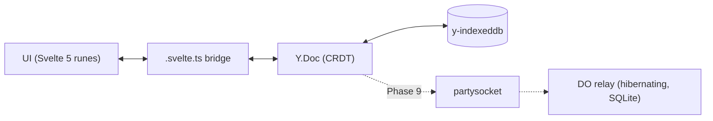

# SyncTicket

**A local-first, real-time collaborative issue tracker.**

[](https://github.com/EleoXDA/SyncTicket/actions/workflows/ci.yml)

## Why this exists

SyncTicket is a portfolio project that takes the hard parts of a Linear-class issue tracker seriously: the browser owns the data (CRDTs in IndexedDB, not a cache of a server), real-time collaboration rides on a Cloudflare Durable Object relay that costs 0 €, and search — lexical and semantic — runs entirely client-side. The interesting problems here are sync, offline correctness, and in-browser ML, not CRUD forms.

## Status

**Phase 3 of 13 complete — the local-first core works.** Issues are created, filtered, sorted, and persisted entirely in the browser (Yjs + IndexedDB); they survive a hard reload with no server involved. Next up is the full CRUD UI (Phase 4). See [docs/ROADMAP.md](docs/ROADMAP.md) for the execution plan with acceptance criteria per phase.

## Architecture

The solid path is live as of Phase 3; the dashed relay arrives in Phase 9:



The Yjs document persisted in IndexedDB is the source of truth; the server (later) is a thin, replaceable websocket relay. Every mutation is local-first and instant by construction — merging, offline queueing, and multi-tab consistency come from the CRDT, not hand-rolled sync code.

## Tech stack

| Choice                                      | Version     | Why                                                            | Decision                                                                |
| ------------------------------------------- | ----------- | -------------------------------------------------------------- | ----------------------------------------------------------------------- |
| Svelte 5 + SvelteKit 2                      | 5.56 / 2.69 | Runes map cleanly onto a CRDT-observing state bridge           | [ADR 0003](docs/adr/0003-ui-stack-svelte5-tailwind4-shadcn-svelte.md)   |
| Tailwind v4 + shadcn-svelte                 | 4.3 / 1.3   | CSS-first theming; components are owned code, not a dependency | [ADR 0003](docs/adr/0003-ui-stack-svelte5-tailwind4-shadcn-svelte.md)   |
| Yjs + y-indexeddb                           | 13.6 / 9.0  | Production-default CRDT; offline + multi-tab for free          | [ADR 0001](docs/adr/0001-sync-engine-yjs-over-electricsql-and-zero.md)  |
| Cloudflare Workers + Durable Objects (free) | —           | Hibernating websocket relay at 0 €                             | [ADR 0002](docs/adr/0002-deploy-target-cloudflare-workers-free-plan.md) |
| No-auth capability URLs                     | —           | Share-a-link collaboration for the demo                        | [ADR 0004](docs/adr/0004-no-auth-workspace-id-demo-mode.md)             |

## Getting started

```sh
pnpm install
pnpm dev                      # vite dev server
pnpm check                    # wrangler types --check + svelte-check (TS strict)
pnpm lint                     # prettier + eslint
pnpm test                     # vitest unit + browser-mode component tests
pnpm exec playwright test     # e2e against the built worker (needs `playwright install chromium`)
pnpm build                    # production build via adapter-cloudflare
pnpm preview                  # the BUILT worker under real workerd (wrangler dev, :4173)
```

## Repository layout

```
src/
├── lib/
│   ├── components/
│   │   ├── ui/          shadcn-svelte components (owned code)
│   │   └── shell/       app chrome: sidebar, theme toggle, command menu
│   ├── hooks/           shared runes hooks
│   ├── model/           plain TS types/enums + pure filter/sort — no Yjs, no runes
│   ├── sync/            Y.Doc schema, CRDT read/write, y-indexeddb persistence
│   ├── state/           .svelte.ts runes bridge + derived query index
│   ├── keyboard/        (Phase 7)  shortcut registry + actions
│   └── search/          (Phase 8)  web worker: FlexSearch + Transformers.js embeddings
├── routes/              SvelteKit routes (/ redirects to /issues)
workers/
└── relay/               (Phase 9)  separate Worker exporting the Yjs Durable Object
docs/
├── ROADMAP.md           13-phase plan with acceptance criteria
└── adr/                 architecture decision records
```

The `workers/relay/` split is deliberate: Durable Object classes cannot be exported from the SvelteKit worker with the stable adapter, so the relay is its own Worker from day one ([ADR 0002](docs/adr/0002-deploy-target-cloudflare-workers-free-plan.md)).

## Decisions (ADRs)

- [0001 — Sync engine: Yjs + Durable Object relay](docs/adr/0001-sync-engine-yjs-over-electricsql-and-zero.md)
- [0002 — Deploy target: Cloudflare Workers free plan, two-worker layout](docs/adr/0002-deploy-target-cloudflare-workers-free-plan.md)
- [0003 — UI stack: Svelte 5 runes, Tailwind v4, shadcn-svelte](docs/adr/0003-ui-stack-svelte5-tailwind4-shadcn-svelte.md)
- [0004 — No auth: workspace ID as capability URL](docs/adr/0004-no-auth-workspace-id-demo-mode.md)

## Engineering notes

<!-- Per-phase writeups accumulate here (measured numbers, tradeoffs, surprises); this section becomes the whitepaper body in Phase 13. -->

### Phases 2–3 — CRDT core and the runes bridge

- **The Y.Doc is the source of truth; the UI reads a projection.** Each workspace is one `Y.Doc` holding a `Y.Map` of issues, each issue a `Y.Map` of scalar fields ([src/lib/sync/doc.ts](src/lib/sync/doc.ts)). A single `observeDeep` on the issues map ([src/lib/state/issues.svelte.ts](src/lib/state/issues.svelte.ts)) patches a `SvelteMap` of plain `Issue` snapshots — top-level events carry whole-issue add/deletes, nested events carry a field change whose `path[0]` is the issue id, so only the touched issues re-snapshot. The derived query index ([src/lib/state/queries.svelte.ts](src/lib/state/queries.svelte.ts)) is pure `$derived` over that projection. Writes never touch local state directly; they mutate the CRDT and the observer updates the view.
- **Layering keeps the CRDT testable without a browser.** `model/` is plain types and pure filter/sort functions (no Yjs, no runes); `sync/` is the only place that (de)serialises a `Y.Map`; `state/` is the runes bridge. This let the CRDT round-trip, fractional ordering, and even two-replica convergence be unit-tested on a bare `Y.Doc` in Node.
- **Persistence must attach synchronously.** y-indexeddb only captures doc updates emitted _after_ it subscribes. A `dynamic import('y-indexeddb')` created a lost-write window — a user who created an issue and reloaded within the chunk-load window lost it. The import is static and browser-guarded; esbuild dead-code-eliminates it from the workerd bundle anyway ([src/lib/sync/persistence.ts](src/lib/sync/persistence.ts)).
- **SSR without a hydration mismatch.** `getIssueStore()` returns a fresh empty store per server render (never a shared singleton) so no request leaks `synced` state into another; the browser gets a session singleton. Both server and first client render show the same unsynced skeleton, then the client hydrates from IndexedDB.
- **A deterministic persistence test.** The reload e2e waits for y-indexeddb's `updates` store to grow past its post-sync baseline before reloading, so it can't race the async IndexedDB commit ([e2e/issues.e2e.ts](e2e/issues.e2e.ts)).

## License

[MIT](LICENSE)
