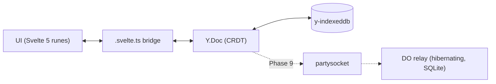

# SyncTicket

**A local-first, real-time collaborative issue tracker.**

[](https://github.com/EleoXDA/SyncTicket/actions/workflows/ci.yml)

## Why this exists

SyncTicket is a portfolio project that takes the hard parts of a Linear-class issue tracker seriously: the browser owns the data (CRDTs in IndexedDB, not a cache of a server), real-time collaboration rides on a Cloudflare Durable Object relay that costs 0 €, and search — lexical and semantic — runs entirely client-side. The interesting problems here are sync, offline correctness, and in-browser ML, not CRUD forms.

## Status

**Phase 1 of 13 — bootstrap & styled shell.** See [docs/ROADMAP.md](docs/ROADMAP.md) for the full execution plan with acceptance criteria per phase.

## Architecture

The target data flow (Phase 1 ships only the shell):



The Yjs document persisted in IndexedDB is the source of truth; the server is a thin, replaceable websocket relay. Every mutation is local-first and instant by construction — merging, offline queueing, and multi-tab consistency come from the CRDT, not hand-rolled sync code.

## Tech stack

| Choice                                      | Version     | Why                                                            | Decision                                                                |
| ------------------------------------------- | ----------- | -------------------------------------------------------------- | ----------------------------------------------------------------------- |
| Svelte 5 + SvelteKit 2                      | 5.56 / 2.69 | Runes map cleanly onto a CRDT-observing state bridge           | [ADR 0003](docs/adr/0003-ui-stack-svelte5-tailwind4-shadcn-svelte.md)   |
| Tailwind v4 + shadcn-svelte                 | 4.3 / 1.3   | CSS-first theming; components are owned code, not a dependency | [ADR 0003](docs/adr/0003-ui-stack-svelte5-tailwind4-shadcn-svelte.md)   |
| Yjs + y-indexeddb                           | 13.6 / 9.0  | Production-default CRDT; offline + multi-tab for free          | [ADR 0001](docs/adr/0001-sync-engine-yjs-over-electricsql-and-zero.md)  |
| Cloudflare Workers + Durable Objects (free) | —           | Hibernating websocket relay at 0 €                             | [ADR 0002](docs/adr/0002-deploy-target-cloudflare-workers-free-plan.md) |
| No-auth capability URLs                     | —           | Share-a-link collaboration for the demo                        | [ADR 0004](docs/adr/0004-no-auth-workspace-id-demo-mode.md)             |

## Getting started

```sh
pnpm install
pnpm dev                      # vite dev server
pnpm check                    # wrangler types --check + svelte-check (TS strict)
pnpm lint                     # prettier + eslint
pnpm test                     # vitest unit + browser-mode component tests
pnpm exec playwright test     # e2e against the built worker (needs `playwright install chromium`)
pnpm build                    # production build via adapter-cloudflare
pnpm preview                  # the BUILT worker under real workerd (wrangler dev, :4173)
```

## Repository layout

```
src/
├── lib/
│   ├── components/
│   │   ├── ui/          shadcn-svelte components (owned code)
│   │   └── shell/       app chrome: sidebar, theme toggle, command menu
│   ├── hooks/           shared runes hooks
│   ├── sync/            (Phase 2)  Y.Doc schema + y-indexeddb persistence
│   ├── state/           (Phase 3)  .svelte.ts runes bridges + derived query index
│   ├── model/           (Phase 2)  plain TS types/enums — no Yjs imports
│   ├── keyboard/        (Phase 7)  shortcut registry + actions
│   └── search/          (Phase 8)  web worker: FlexSearch + Transformers.js embeddings
├── routes/              SvelteKit routes (/ redirects to /issues)
workers/
└── relay/               (Phase 9)  separate Worker exporting the Yjs Durable Object
docs/
├── ROADMAP.md           13-phase plan with acceptance criteria
└── adr/                 architecture decision records
```

The `workers/relay/` split is deliberate: Durable Object classes cannot be exported from the SvelteKit worker with the stable adapter, so the relay is its own Worker from day one ([ADR 0002](docs/adr/0002-deploy-target-cloudflare-workers-free-plan.md)).

## Decisions (ADRs)

- [0001 — Sync engine: Yjs + Durable Object relay](docs/adr/0001-sync-engine-yjs-over-electricsql-and-zero.md)
- [0002 — Deploy target: Cloudflare Workers free plan, two-worker layout](docs/adr/0002-deploy-target-cloudflare-workers-free-plan.md)
- [0003 — UI stack: Svelte 5 runes, Tailwind v4, shadcn-svelte](docs/adr/0003-ui-stack-svelte5-tailwind4-shadcn-svelte.md)
- [0004 — No auth: workspace ID as capability URL](docs/adr/0004-no-auth-workspace-id-demo-mode.md)

## Engineering notes

<!-- Per-phase writeups accumulate here (measured numbers, tradeoffs, surprises); this section becomes the whitepaper body in Phase 13. -->

## License

[MIT](LICENSE)
