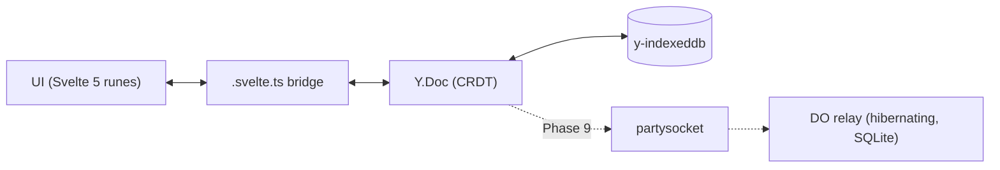

# SyncTicket

**A local-first, real-time collaborative issue tracker.**

[](https://github.com/EleoXDA/SyncTicket/actions/workflows/ci.yml)

## Why this exists

SyncTicket is a portfolio project that takes the hard parts of a Linear-class issue tracker seriously: the browser owns the data (CRDTs in IndexedDB, not a cache of a server), real-time collaboration rides on a Cloudflare Durable Object relay that costs 0 €, and search — lexical and semantic — runs entirely client-side. The interesting problems here are sync, offline correctness, and in-browser ML, not CRUD forms.

## Status

**Phase 9 of 13 complete — two browsers now stay in step.** Everything still works offline and local-first; when a relay is configured, edits made in one browser reach another in well under a second, and a workspace survives every client leaving. The relay is a second Cloudflare Worker with a hibernating Durable Object, so an idle room costs nothing. Next up is presence and awareness (Phase 10). See [docs/ROADMAP.md](docs/ROADMAP.md) for the execution plan with acceptance criteria per phase.

## Architecture

The solid path is live as of Phase 3; the dashed relay arrives in Phase 9:



The Yjs document persisted in IndexedDB is the source of truth; the server (later) is a thin, replaceable websocket relay. Every mutation is local-first and instant by construction — merging and offline queueing come from the CRDT, not hand-rolled sync code. (Live multi-tab convergence is _not_ free: y-indexeddb 9.0.12 has no BroadcastChannel, so a second tab picks up changes on reload until the Phase 9 relay lands.)

## Tech stack

| Choice                                      | Version     | Why                                                              | Decision                                                                |
| ------------------------------------------- | ----------- | ---------------------------------------------------------------- | ----------------------------------------------------------------------- |
| Svelte 5 + SvelteKit 2                      | 5.56 / 2.69 | Runes map cleanly onto a CRDT-observing state bridge             | [ADR 0003](docs/adr/0003-ui-stack-svelte5-tailwind4-shadcn-svelte.md)   |
| Tailwind v4 + shadcn-svelte                 | 4.3 / 1.3   | CSS-first theming; components are owned code, not a dependency   | [ADR 0003](docs/adr/0003-ui-stack-svelte5-tailwind4-shadcn-svelte.md)   |
| Yjs + y-indexeddb                           | 13.6 / 9.0  | Production-default CRDT; offline writes and conflict-free merges | [ADR 0001](docs/adr/0001-sync-engine-yjs-over-electricsql-and-zero.md)  |
| Cloudflare Workers + Durable Objects (free) | —           | Hibernating websocket relay at 0 €                               | [ADR 0002](docs/adr/0002-deploy-target-cloudflare-workers-free-plan.md) |
| No-auth capability URLs                     | —           | Share-a-link collaboration for the demo                          | [ADR 0004](docs/adr/0004-no-auth-workspace-id-demo-mode.md)             |

## Getting started

```sh
pnpm install
pnpm demo                     # relay + app together, with live sync on (recommended)
pnpm dev                      # app only, local-first, no relay
pnpm check                    # wrangler types --check + svelte-check (TS strict)
pnpm lint                     # prettier + eslint
pnpm test                     # vitest unit + browser-mode component tests
pnpm exec playwright test     # e2e against the built worker (needs `playwright install chromium`)
pnpm build                    # production build via adapter-cloudflare
pnpm preview                  # the BUILT worker under real workerd (wrangler dev, :4173)
```

## Trying the collaboration

```sh
pnpm demo
```

Open <http://localhost:5173/issues>. You land in a workspace of your own — the id is random and unguessable, because in demo mode knowing the link _is_ the access ([ADR 0004](docs/adr/0004-no-auth-workspace-id-demo-mode.md)). Press **Share** in the header to copy an invite link, open it in a different browser, and the two stay in step. A browser that was never given the link sees nothing.

Without a relay (`pnpm dev`) everything still works; it is simply local to that browser.

## Repository layout

```
src/
├── lib/
│   ├── components/
│   │   ├── ui/          shadcn-svelte components (owned code)
│   │   ├── issues/      issue UI: row, create dialog, detail sheet, board, pickers, badges
│   │   └── shell/       app chrome: sidebar, theme toggle, command menu
│   ├── hooks/           shared runes hooks
│   ├── model/           plain TS types/enums + pure filter/sort — no Yjs, no runes
│   ├── sync/            Y.Doc schema, CRDT read/write, y-indexeddb persistence
│   ├── state/           .svelte.ts runes bridge + derived query index
│   ├── keyboard/        chord parsing/matching + the shortcut registry
│   └── search/          web worker: FlexSearch index, optional embeddings, RRF fusion
├── routes/              SvelteKit routes (/ redirects to /issues; /issues/[id] is the detail sheet; /board)
workers/
└── relay/               separate Worker: the Yjs Durable Object room server
docs/
├── ROADMAP.md           13-phase plan with acceptance criteria
└── adr/                 architecture decision records
```

The `workers/relay/` split is deliberate: Durable Object classes cannot be exported from the SvelteKit worker with the stable adapter, so the relay is its own Worker from day one ([ADR 0002](docs/adr/0002-deploy-target-cloudflare-workers-free-plan.md)).

## Decisions (ADRs)

- [0001 — Sync engine: Yjs + Durable Object relay](docs/adr/0001-sync-engine-yjs-over-electricsql-and-zero.md)
- [0002 — Deploy target: Cloudflare Workers free plan, two-worker layout](docs/adr/0002-deploy-target-cloudflare-workers-free-plan.md)
- [0003 — UI stack: Svelte 5 runes, Tailwind v4, shadcn-svelte](docs/adr/0003-ui-stack-svelte5-tailwind4-shadcn-svelte.md)
- [0004 — No auth: workspace ID as capability URL](docs/adr/0004-no-auth-workspace-id-demo-mode.md)
- [0005 — Virtualized lists: virtua, and a cap for the board](docs/adr/0005-virtual-list-virtua-over-tanstack-and-svelte-virtuallists.md)
- [0006 — Search: FlexSearch, with local embeddings as an opt-in](docs/adr/0006-search-flexsearch-lexical-with-optional-local-embeddings.md)

## Engineering notes

<!-- Per-phase writeups accumulate here (measured numbers, tradeoffs, surprises); this section becomes the whitepaper body in Phase 13. -->

### Phases 2–3 — CRDT core and the runes bridge

- **The Y.Doc is the source of truth; the UI reads a projection.** Each workspace is one `Y.Doc` holding a `Y.Map` of issues, each issue a `Y.Map` of scalar fields ([src/lib/sync/doc.ts](src/lib/sync/doc.ts)). A single `observeDeep` on the issues map ([src/lib/state/issues.svelte.ts](src/lib/state/issues.svelte.ts)) patches a `SvelteMap` of plain `Issue` snapshots — top-level events carry whole-issue add/deletes, nested events carry a field change whose `path[0]` is the issue id, so only the touched issues re-snapshot. The derived query index ([src/lib/state/queries.svelte.ts](src/lib/state/queries.svelte.ts)) is pure `$derived` over that projection. Writes never touch local state directly; they mutate the CRDT and the observer updates the view.
- **Layering keeps the CRDT testable without a browser.** `model/` is plain types and pure filter/sort functions (no Yjs, no runes); `sync/` is the only place that (de)serialises a `Y.Map`; `state/` is the runes bridge. This let the CRDT round-trip, fractional ordering, and even two-replica convergence be unit-tested on a bare `Y.Doc` in Node.
- **Persistence must attach synchronously.** y-indexeddb only captures doc updates emitted _after_ it subscribes. A `dynamic import('y-indexeddb')` created a lost-write window — a user who created an issue and reloaded within the chunk-load window lost it. The import is static and browser-guarded; esbuild dead-code-eliminates it from the workerd bundle anyway ([src/lib/sync/persistence.ts](src/lib/sync/persistence.ts)).
- **SSR without a hydration mismatch.** `getIssueStore()` returns a fresh empty store per server render (never a shared singleton) so no request leaks `synced` state into another; the browser gets a session singleton. Both server and first client render show the same unsynced skeleton, then the client hydrates from IndexedDB.
- **A deterministic persistence test.** The reload e2e waits for y-indexeddb's `updates` store to grow past its post-sync baseline before reloading, so it can't race the async IndexedDB commit ([e2e/issues.e2e.ts](e2e/issues.e2e.ts)).

### Phase 4 — the CRUD UI, and what was not obvious

- **The detail view is a route, not component state.** `/issues/[id]` renders the sheet; the list lives in `issues/+layout.svelte` so it stays mounted behind it, keeping filter, sort and the quick-add draft alive across the round trip. The payoff is that an issue is a shareable, reloadable URL and the browser Back button closes the sheet. The cost is a second code-split chunk, which is a real problem offline: the first navigation to an issue after losing connectivity has no code to fetch and lands on an error page. The layout calls `preloadCode('/issues/*')` on mount to close that gap, and the offline e2e visits the route once before `setOffline(true)` rather than racing the preload.
- **`{#key}` does not reset a component's own state.** Editable fields hold a _nullable draft_: `null` means "not editing" and the input renders the live CRDT value, so a remote change flows straight through; the first keystroke makes the draft non-null and commit writes it back. Drafts must therefore be discarded when the sheet switches issues — and `{#key issue.id}` re-creates the DOM subtree but leaves the enclosing component's `$state` untouched. Only a component boundary resets it, so the editable body is its own component ([issue-editor.svelte](src/lib/components/issues/issue-editor.svelte)) rendered inside the key block. The create form is a child of `Dialog.Content` for the same reason: bits-ui unmounts it on close, so a cancelled draft cannot survive into the next open. There is deliberately no `$effect` anywhere in the editing path — drafts are set from DOM events only, so there is no state-syncing loop to get wrong.
- **Write invariants belong in the CRDT layer.** `patchIssue` now drops fields already equal to their stored value and ignores a blank title ([sync/issues.ts](src/lib/sync/issues.ts)). Both started as UI concerns and both are wrong there: re-selecting the current status from a picker would otherwise mint a new Y item, bump `updatedAt` (silently reshuffling the "recent" sort) and, from Phase 9, cost a relay message and a fresh last-writer-wins window; and since `readIssue` only defaults a _missing_ title, a persisted `''` would render as an empty row forever. Pushing both into the one place that serialises a `Y.Map` makes them true for every caller, and testable on a bare `Y.Doc` in Node.
- **Closing the sheet has three exits, and only one of them fires `blur`.** Overlay click, Back button and route change all unmount the editor without it, so an uncommitted draft would vanish. The editor flushes pending drafts in `onDestroy`, which is what makes "it saved what I typed" true on every path. Escape is handled per field instead of on the sheet: it reverts the field being edited and stops propagating, so a second Escape — with no draft in flight — reaches bits-ui's document-level listener and closes the sheet.
- **"Within one frame" is asserted synchronously.** Yjs fires `observeDeep` synchronously inside `transact`, and the `SvelteMap` write schedules a microtask flush. The component test writes through the store, calls `flushSync()`, then asserts with a plain `expect` on the DOM node — a polling `expect.element` would pass even if the update landed several frames later, which is exactly the property under test.

### Phase 5 — the board, and why fractional indexing is the hard part

- **Two replicas will mint the same order key, and that key is a crash.** Fractional indexing assigns each issue a string that sorts between its neighbours, so a reorder is one write instead of renumbering a column. The catch is that the keys are deterministic: two browsers creating their first issue offline both produce `"a0"`. Sorting already coped with that (the id tiebreak from Phase 3), but `generateKeyBetween` _throws_ when its two bounds are equal, so the first drag between those two cards would take the board down. The fix is two-layered ([sync/order.ts](src/lib/sync/order.ts)): every generated key carries a short random suffix so replicas stop colliding, and `planRepairs` heals equal keys that already exist, rewriting only the offending run rather than the column — Phase 6 targets 10k issues, where a full rewrite would be thousands of CRDT writes.
- **The suffix cannot simply be appended.** `generateKeyBetween` often returns a proper _prefix_ of its upper bound, and appending to a prefix sorts past it. Guarding by falling back to the bare key looked correct and was almost useless: dropping a card at the top of a column is the single most common gesture, and there the bound is always a suffixed key, so the guard fired essentially every time and handed both replicas the same deterministic key again. `orderKeyBetween` instead descends toward the bound and retries, so the jitter survives.
- **A drag does not report itself the way the docs suggest.** A keyboard drop arrives as a `consider` event with trigger `dragStopped` and no `finalize` at all, while every arrow press fires a full `finalize` mid-drag. Committing on `finalize` would mint one order key per keystroke and leave a column frozen on a stale preview forever. The rules are extracted into pure functions ([components/issues/board-drag.ts](src/lib/components/issues/board-drag.ts)) and unit-tested in Node against sequences taken from the library's source and confirmed in a real browser.
- **A dragged card is a drag item first and a link second.** svelte-dnd-action drops the zone's direct children out of the tab order during a drag but not their descendants — and tabbing onto a column is the only way to move a card between columns with the keyboard. A card built like the list row (a link between two dropdown triggers) would put two tab stops per card between the user and the next column. So board cards have no focusable children: status and priority are static badges, the card opens the detail sheet itself, and Space is registered as the drag trigger so Enter stays free.
- **A drag that changes nothing writes nothing.** Dropping a card back where it started, or abandoning one outside every column, still fires a drop event. Because keys carry random jitter, comparing the new key to the old one would always differ, so `moveIssue` asks the question that matters instead: does the key it already has still sort it into the slot it now occupies?
- **The board is driven by the keyboard in tests.** The library detects pointer drop zones on a 200 ms polling timer and animates the drop before reporting it, so a synthetic mouse drag is a timing bet. The keyboard path is exact, and the e2e asserts the text of the library's live region, which is the same sentence a screen-reader user hears.

### Phase 6 — measuring before optimising

Ten thousand issues, measured in Chromium before changing anything:

| Measurement (10,000 issues)            | Before   | After     |
| -------------------------------------- | -------- | --------- |
| `filterIssues` + `sortIssues` over 10k | 2.0 ms   | 1.6 ms    |
| Render the list                        | 5,019 ms | **33 ms** |
| `<li>` elements in the DOM             | 10,000   | **20**    |
| DOM nodes                              | 168,011  | **383**   |
| One field edit reaching the DOM        | 0.7 ms   | 0.4 ms    |

- **The reactive layer was never the bottleneck.** Filtering and sorting the entire ten thousand costs 2 ms, and a single edit still reaches the DOM in under a millisecond with everything mounted. The CRDT-to-runes bridge from Phase 3 simply scales. What did not scale was seventeen DOM nodes per row rendered ten thousand times — most of them belonging to the two dropdown pickers. Measuring first meant the fix was one component instead of a rewrite of the query index.
- **The library choice came down to a house rule.** The roadmap's pin has not shipped since March 2025, and its documented fallback — `@tanstack/svelte-virtual` — returns a `svelte/store` `Readable`, which this project banned in ADR 0003. virtua is runes-native, actively developed, and its `Virtualizer` lets the item element be a real `<li>` inside a real `<ul>`, so the rows keep their list semantics and every existing test still finds them ([ADR 0005](docs/adr/0005-virtual-list-virtua-over-tanstack-and-svelte-virtuallists.md)).
- **Virtualization and drag-and-drop cannot coexist here.** svelte-dnd-action indexes the drop zone's direct children positionally, so rendering only a window would hide the rest of the column from the drag machinery. The board is therefore capped at 100 cards per column rather than virtualized — 194 ms and 1,922 nodes instead of 907 ms and 38,979 — and a drop still sorts correctly against the cards behind the cap, because the handler passes their ids along as the tail of the new order.
- **The list is now its own scroll container**, because virtua measures the virtualizer's direct parent. The toolbar stays put and only the list scrolls, which is the layout this project is imitating anyway.

### Phase 7 — a global shortcut is mostly a list of things not to do

- **`Enter` and the arrow keys must not be global.** The obvious design registers every key in one place, and it breaks the app: a document-level handler that calls `preventDefault` on Enter suppresses button activation, link navigation and implicit form submission everywhere at once — verified in Chromium before writing the code. So the registry holds only genuine commands, the issue list owns its own cursor keys, and opening an issue is a focused link being activated by the browser rather than a shortcut pretending to be one.
- **The list cursor is focus, not an ARIA selection.** `aria-selected` is not valid on a `listitem`, and virtua renders the `<ul>` itself so nothing can be attached to it. Moving the cursor therefore moves _real_ focus to the row's link, which is what makes a screen reader announce it, with a roving `tabindex` so one Tab enters the list at the cursor rather than walking 10,000 rows. In a virtualized list the target row usually is not mounted, so the cursor's index is pinned with virtua's `keepMounted` — without it, focus silently fails to land on any row far from the viewport.
- **`?` is a character, not a key combination.** Matching it as "Shift plus /" works under Playwright and never fires on a real keyboard, where the event reports `?` directly — and on a German or French layout it is not Shift+/ at all. Chords match the character the keyboard produces, and the shift state is ignored for punctuation, so the shortcut follows the user's layout.
- **The palette had to be allowed to close itself.** `⌘K` lands on the palette's own input, which is a combobox inside a dialog, so the guards that keep single letters out of text fields would have made the shortcut open-only. It opts into both. On Linux and Windows there was a second trap: bits-ui's Command treats Ctrl+K as "previous item" and prevents the default, so `vimBindings` is switched off.
- **The board stands the registry down mid-drag.** A keyboard drag has the user holding a card while pressing arrows and Tab; a stray `c` or `b` would open a dialog or navigate away and strand the gesture. Leaving the board while dragging clears the suspension, or every shortcut in the app would stay dead.

### Phase 8 — search that never phones home

- **The engine was chosen on the query that matters, not the average one.** Two libraries were measured over 10,000 issues. MiniSearch has the better API and updates its index thirteen times faster, which counts when the corpus is a live CRDT — but it scores every match, so a single-letter first keystroke costs 3.96 ms against FlexSearch's 0.005 ms, and that gap grows with the corpus. FlexSearch stops once it has enough ([ADR 0006](docs/adr/0006-search-flexsearch-lexical-with-optional-local-embeddings.md)).
- **Title and description are indexed as one field, and the title again.** FlexSearch needs every term of a query to appear in the same field, so indexing the two separately makes "sync offline" return nothing when the words are split across them — worse than the substring filter it replaces. Indexing the title on its own as well is what keeps title matches ranked first. Its `limit` is per field too, so asking for twenty results without merging returns forty.
- **"No network at query time" is asserted, not claimed.** An end-to-end test records every request the page makes while five queries are typed and asserts the list is empty; another turns the network off and searches anyway.
- **The lazy import was nearly a lie.** Vite's default worker format cannot code-split, so it silently inlines dynamic imports — the embedding library would have shipped to every visitor the moment the search worker started, opt-in or not. One line of config (`worker: { format: 'es' }`) is the difference between a 51 KB worker and a 500 KB one.
- **Embedding yields, or the type-ahead stops.** ONNX inference is synchronous on the thread that calls it, so embedding ten thousand issues in one pass would block the worker for minutes with queries queued behind it. Batches are small and hand the message queue back between them, vectors are dropped per document when its text changes, and a generation counter abandons a batch whose corpus moved underneath it. The worker only reports `hybrid` when every document actually has a current vector.
- **The palette had to stop filtering itself.** bits-ui scores each item against the query and hides the rest — which would delete precisely the results hybrid search exists to find, since a description-only match scores zero against its title. Filtering is off, and re-implemented for the commands with bits-ui's own scoring function so they behave exactly as before.

### Phase 9 — the relay, and two things the plan had wrong

- **The provider is not where the roadmap said it was.** The plan called for `partysocket`'s `YProvider`; `partysocket` exports no Yjs provider at all. It lives in `y-partyserver/provider`, as a default export, and `partysocket` is never imported.
- **A party name decided whether anything worked.** partyserver derives the URL namespace by kebab-casing the Durable Object _binding_ name, while the client provider defaults to a party called `main`. With the binding `YDocRoom` the only reachable path is `/parties/y-doc-room/<workspace>`, and the default answers HTTP 400 — a mismatch that would have looked like a hang rather than an error. Probing the running relay confirmed all three cases before a line of client code was written.
- **Hibernation is what makes an idle room free, and what makes persistence load-bearing.** Eviction takes the in-memory document with it, so `onLoad` rebuilds from the room's own SQLite table and `onSave` writes it back. The save debounce is shortened from the default 2 s / 10 s, because that is a long time to hold the only copy of a change in memory that is about to be discarded.
- **A relay forced workspace identity to land early.** Until now each test was isolated because each browser context started with an empty IndexedDB. A shared relay room removes that: every test would join the same room and inherit the others' issues, and the room's storage outlives the process, so the second local run would start dirty. Workspaces are now identified by an id carried in the URL and remembered, which is also the first step toward the capability URL in [ADR 0004](docs/adr/0004-no-auth-workspace-id-demo-mode.md).
- **The sub-second claim is measured, not asserted once.** A single timing sample on a shared runner is a coin flip, so the test takes five round trips and judges the median, attaching the samples to the report. The individual ceilings stay generous, so a slow machine fails slowly rather than falsely.
- **The offline test had to be made honest.** Playwright's offline mode does not close a socket that is already open, so the first version synced anyway and proved nothing. It now blocks the relay at the WebSocket route, writes while genuinely cut off, verifies the other browser sees nothing, then lets the relay through and watches it converge.

## License

[MIT](LICENSE)
