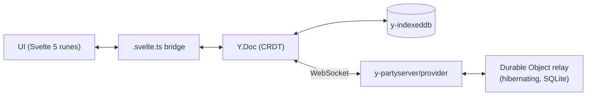
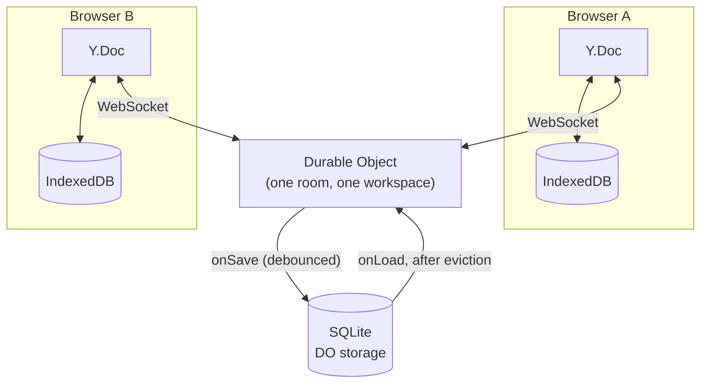

# SyncTicket

**A local-first, real-time collaborative issue tracker.**

[](https://github.com/EleoXDA/SyncTicket/actions/workflows/ci.yml)

## Why this exists

SyncTicket is a portfolio project that takes the hard parts of a Linear-class issue tracker seriously: the browser owns the data (CRDTs in IndexedDB, not a cache of a server), real-time collaboration rides on a Cloudflare Durable Object relay that costs 0 €, presence and connection state tell the truth even when the underlying libraries won't do it for free, and search — lexical and semantic — runs entirely client-side with zero third-party dependency, even for the model. The interesting problems here are sync, offline correctness, distributed liveness, and in-browser ML, not CRUD forms.

## Status

**All 13 phases done but one.** Every engineering decision below is complete, tested, and current — presence, connection resilience, and a fully self-hosted demo all shipped in Phases 10–12. The one thing left is the live `wrangler deploy` of both workers: it needs a Cloudflare account this environment has never had connected (confirmed with `wrangler whoami`, not assumed), and that is an authentication step an agent session should not take on a user's behalf without being asked. Both workers already pass `wrangler deploy --dry-run` cleanly; [docs/DEPLOY.md](docs/DEPLOY.md) is the exact two-command runbook for whoever has the credentials to finish it. See [docs/ROADMAP.md](docs/ROADMAP.md) for the full 13-phase plan with acceptance criteria per phase.

## Architecture

The CRDT-to-runes path has been live since Phase 3; the relay since Phase 9. Both are load-bearing today, not aspirational:



The Yjs document persisted in IndexedDB is the source of truth; the relay is a thin, replaceable websocket server that exists to let two browsers find out about each other's edits. Every mutation is local-first and instant by construction — merging and offline queueing come from the CRDT, not hand-rolled sync code. (Live multi-tab convergence needs a relay configured, even one that is currently unreachable: y-indexeddb 9.0.12 has no BroadcastChannel of its own, but the relay provider carries one, subscribed the moment it is constructed rather than once it actually connects — so two tabs of the same browser converge instantly through it, offline or not. With no relay configured at all, a second tab only picks up changes on reload.)

What makes the relay worth a diagram of its own is what happens when nobody is using it. A Cloudflare Durable Object bills for the time it is resident in memory, not for existing, so an idle room needs to actually be evicted to cost nothing — and Workers' WebSocket Hibernation is what lets that happen while a socket stays technically open:



The instance's in-memory state — including the live `Y.Doc` and the awareness map that drives presence — is exactly what hibernation evicts, so both have to be reconstructible from the DO's own SQLite table rather than assumed to survive. That single fact turned out to explain three separate bugs across three phases: `onLoad` has to rebuild the document from storage (Phase 9), a woken instance's awareness map starts empty so presence needs its own liveness rather than trusting the protocol's (Phase 10), and a connection that goes quiet without closing needs a client-side nudge because the library never notices on its own (Phase 11). See the engineering notes below for each.

## Tech stack

| Choice                                      | Version     | Why                                                                               | Decision                                                                                                                                                           |
| ------------------------------------------- | ----------- | --------------------------------------------------------------------------------- | ------------------------------------------------------------------------------------------------------------------------------------------------------------------ |
| Svelte 5 + SvelteKit 2                      | 5.56 / 2.69 | Runes map cleanly onto a CRDT-observing state bridge                              | [ADR 0003](docs/adr/0003-ui-stack-svelte5-tailwind4-shadcn-svelte.md)                                                                                              |
| Tailwind v4 + shadcn-svelte                 | 4.3 / 1.3   | CSS-first theming; components are owned code, not a dependency                    | [ADR 0003](docs/adr/0003-ui-stack-svelte5-tailwind4-shadcn-svelte.md)                                                                                              |
| Yjs + y-indexeddb                           | 13.6 / 9.0  | Production-default CRDT; offline writes and conflict-free merges                  | [ADR 0001](docs/adr/0001-sync-engine-yjs-over-electricsql-and-zero.md)                                                                                             |
| Cloudflare Workers + Durable Objects (free) | —           | Hibernating websocket relay at 0 €                                                | [ADR 0002](docs/adr/0002-deploy-target-cloudflare-workers-free-plan.md)                                                                                            |
| No-auth capability URLs                     | —           | Share-a-link collaboration for the demo                                           | [ADR 0004](docs/adr/0004-no-auth-workspace-id-demo-mode.md)                                                                                                        |
| virtua                                      | 0.51        | Runes-native virtualization; a real `<li>`/`<ul>` for assistive tech              | [ADR 0005](docs/adr/0005-virtual-list-virtua-over-tanstack-and-svelte-virtuallists.md)                                                                             |
| FlexSearch + optional local embeddings      | 0.8 / 4.2   | Sub-millisecond lexical search at 10k issues; semantic search opt-in, self-hosted | [ADR 0006](docs/adr/0006-search-flexsearch-lexical-with-optional-local-embeddings.md), [ADR 0009](docs/adr/0009-self-host-the-embedding-model-and-onnx-runtime.md) |

## Getting started

```sh
pnpm install
pnpm fetch:search-assets      # optional — vendors the embedding model + ONNX runtime (~46 MB,
                               # gitignored) so "Add meaning search" works; skip if you only
                               # want lexical search, which needs nothing extra (ADR 0009)
pnpm demo                     # relay + app together, with live sync on (recommended)
pnpm dev                      # app only, local-first, no relay
pnpm check                    # wrangler types --check + svelte-check (TS strict)
pnpm lint                     # prettier + eslint
pnpm test                     # vitest unit + browser-mode component tests
pnpm exec playwright test     # e2e against the built worker (needs `playwright install chromium`)
pnpm build                    # production build via adapter-cloudflare
pnpm preview                  # the BUILT worker under real workerd (wrangler dev, :4173)
```

## Trying the collaboration

```sh
pnpm demo
```

Open <http://localhost:5173/issues>. You land in a workspace of your own — the id is random and unguessable, because in demo mode knowing the link _is_ the access ([ADR 0004](docs/adr/0004-no-auth-workspace-id-demo-mode.md)). It starts empty; click **Load example issues** for a curated backlog to try search, filters and the board against immediately, rather than typing your own. Press **Share** in the header to copy an invite link, open it in a different browser, and the two stay in step. A browser that was never given the link sees nothing.

Without a relay (`pnpm dev`) everything still works; it is simply local to that browser.

**This is a demo, not a private tracker.** There is no authentication by design
([ADR 0004](docs/adr/0004-no-auth-workspace-id-demo-mode.md)) — the unguessable workspace id
in the URL is the only thing protecting a workspace, so anyone who has the link can read and
edit it, and anyone you send it to can pass it on. Don't put real or sensitive data in one.

For the fuller walkthrough — concurrent edits, going offline mid-edit, and what the
connection popover says at each step — see [docs/DEMO.md](docs/DEMO.md), which is also a
Playwright test (`e2e/demo.e2e.ts`), copy and all.

## Repository layout

```
src/
├── lib/
│   ├── components/
│   │   ├── ui/          shadcn-svelte components (owned code)
│   │   ├── issues/      issue UI: row, create dialog, detail sheet, board, pickers, badges
│   │   └── shell/       app chrome: sidebar, theme toggle, command menu
│   ├── hooks/           shared runes hooks
│   ├── model/           plain TS types/enums + pure filter/sort — no Yjs, no runes
│   ├── sync/            Y.Doc schema, CRDT read/write, y-indexeddb persistence
│   ├── state/           .svelte.ts runes bridge + derived query index
│   ├── keyboard/        chord parsing/matching + the shortcut registry
│   └── search/          web worker: FlexSearch index, optional embeddings, RRF fusion
├── routes/              SvelteKit routes (/ redirects to /issues; /issues/[id] is the detail sheet; /board)
workers/
└── relay/               separate Worker: the Yjs Durable Object room server
scripts/
└── fetch-search-assets.mjs   vendors the embedding model + ONNX runtime (ADR 0009)
docs/
├── ROADMAP.md           13-phase plan with acceptance criteria
├── DEMO.md              the two-browser walkthrough, mirrored by e2e/demo.e2e.ts
├── DEPLOY.md            the runbook for a real `wrangler deploy` of both workers
└── adr/                 architecture decision records
```

The `workers/relay/` split is deliberate: Durable Object classes cannot be exported from the SvelteKit worker with the stable adapter, so the relay is its own Worker from day one ([ADR 0002](docs/adr/0002-deploy-target-cloudflare-workers-free-plan.md)).

## Decisions (ADRs)

- [0001 — Sync engine: Yjs + Durable Object relay](docs/adr/0001-sync-engine-yjs-over-electricsql-and-zero.md)
- [0002 — Deploy target: Cloudflare Workers free plan, two-worker layout](docs/adr/0002-deploy-target-cloudflare-workers-free-plan.md)
- [0003 — UI stack: Svelte 5 runes, Tailwind v4, shadcn-svelte](docs/adr/0003-ui-stack-svelte5-tailwind4-shadcn-svelte.md)
- [0004 — No auth: workspace ID as capability URL](docs/adr/0004-no-auth-workspace-id-demo-mode.md)
- [0005 — Virtualized lists: virtua, and a cap for the board](docs/adr/0005-virtual-list-virtua-over-tanstack-and-svelte-virtuallists.md)
- [0006 — Search: FlexSearch, with local embeddings as an opt-in](docs/adr/0006-search-flexsearch-lexical-with-optional-local-embeddings.md)
- [0007 — Presence liveness is owned by the client, not the protocol](docs/adr/0007-presence-liveness-is-owned-by-the-client.md)
- [0008 — Connection liveness: nudge the socket, never call disconnect()](docs/adr/0008-connection-liveness-nudge-not-reconnect.md)
- [0009 — Self-host the embedding model and the ONNX runtime](docs/adr/0009-self-host-the-embedding-model-and-onnx-runtime.md)

## Engineering notes

Per-phase writeups: measured numbers, tradeoffs, and the surprises that only showed up once real code ran against a real installed package rather than its documentation. Read straight through, this is the whitepaper — every architectural decision this project made, and why, without needing to open a single ADR (though each one is linked, for whoever wants the full context, the alternatives considered, and the consequences accepted).

### Phases 2–3 — CRDT core and the runes bridge

- **The Y.Doc is the source of truth; the UI reads a projection.** Each workspace is one `Y.Doc` holding a `Y.Map` of issues, each issue a `Y.Map` of scalar fields ([src/lib/sync/doc.ts](src/lib/sync/doc.ts)). A single `observeDeep` on the issues map ([src/lib/state/issues.svelte.ts](src/lib/state/issues.svelte.ts)) patches a `SvelteMap` of plain `Issue` snapshots — top-level events carry whole-issue add/deletes, nested events carry a field change whose `path[0]` is the issue id, so only the touched issues re-snapshot. The derived query index ([src/lib/state/queries.svelte.ts](src/lib/state/queries.svelte.ts)) is pure `$derived` over that projection. Writes never touch local state directly; they mutate the CRDT and the observer updates the view.
- **Layering keeps the CRDT testable without a browser.** `model/` is plain types and pure filter/sort functions (no Yjs, no runes); `sync/` is the only place that (de)serialises a `Y.Map`; `state/` is the runes bridge. This let the CRDT round-trip, fractional ordering, and even two-replica convergence be unit-tested on a bare `Y.Doc` in Node.
- **Persistence must attach synchronously.** y-indexeddb only captures doc updates emitted _after_ it subscribes. A `dynamic import('y-indexeddb')` created a lost-write window — a user who created an issue and reloaded within the chunk-load window lost it. The import is static and browser-guarded; esbuild dead-code-eliminates it from the workerd bundle anyway ([src/lib/sync/persistence.ts](src/lib/sync/persistence.ts)).
- **SSR without a hydration mismatch.** `getIssueStore()` returns a fresh empty store per server render (never a shared singleton) so no request leaks `synced` state into another; the browser gets a session singleton. Both server and first client render show the same unsynced skeleton, then the client hydrates from IndexedDB.
- **A deterministic persistence test.** The reload e2e waits for y-indexeddb's `updates` store to grow past its post-sync baseline before reloading, so it can't race the async IndexedDB commit ([e2e/issues.e2e.ts](e2e/issues.e2e.ts)).

### Phase 4 — the CRUD UI, and what was not obvious

- **The detail view is a route, not component state.** `/issues/[id]` renders the sheet; the list lives in `issues/+layout.svelte` so it stays mounted behind it, keeping filter, sort and the quick-add draft alive across the round trip. The payoff is that an issue is a shareable, reloadable URL and the browser Back button closes the sheet. The cost is a second code-split chunk, which is a real problem offline: the first navigation to an issue after losing connectivity has no code to fetch and lands on an error page. The layout calls `preloadCode('/issues/*')` on mount to close that gap, and the offline e2e visits the route once before `setOffline(true)` rather than racing the preload.
- **`{#key}` does not reset a component's own state.** Editable fields hold a _nullable draft_: `null` means "not editing" and the input renders the live CRDT value, so a remote change flows straight through; the first keystroke makes the draft non-null and commit writes it back. Drafts must therefore be discarded when the sheet switches issues — and `{#key issue.id}` re-creates the DOM subtree but leaves the enclosing component's `$state` untouched. Only a component boundary resets it, so the editable body is its own component ([issue-editor.svelte](src/lib/components/issues/issue-editor.svelte)) rendered inside the key block. The create form is a child of `Dialog.Content` for the same reason: bits-ui unmounts it on close, so a cancelled draft cannot survive into the next open. There is deliberately no `$effect` anywhere in the editing path — drafts are set from DOM events only, so there is no state-syncing loop to get wrong.
- **Write invariants belong in the CRDT layer.** `patchIssue` now drops fields already equal to their stored value and ignores a blank title ([sync/issues.ts](src/lib/sync/issues.ts)). Both started as UI concerns and both are wrong there: re-selecting the current status from a picker would otherwise mint a new Y item, bump `updatedAt` (silently reshuffling the "recent" sort) and, from Phase 9, cost a relay message and a fresh last-writer-wins window; and since `readIssue` only defaults a _missing_ title, a persisted `''` would render as an empty row forever. Pushing both into the one place that serialises a `Y.Map` makes them true for every caller, and testable on a bare `Y.Doc` in Node.
- **Closing the sheet has three exits, and only one of them fires `blur`.** Overlay click, Back button and route change all unmount the editor without it, so an uncommitted draft would vanish. The editor flushes pending drafts in `onDestroy`, which is what makes "it saved what I typed" true on every path. Escape is handled per field instead of on the sheet: it reverts the field being edited and stops propagating, so a second Escape — with no draft in flight — reaches bits-ui's document-level listener and closes the sheet.
- **"Within one frame" is asserted synchronously.** Yjs fires `observeDeep` synchronously inside `transact`, and the `SvelteMap` write schedules a microtask flush. The component test writes through the store, calls `flushSync()`, then asserts with a plain `expect` on the DOM node — a polling `expect.element` would pass even if the update landed several frames later, which is exactly the property under test.

### Phase 5 — the board, and why fractional indexing is the hard part

- **Two replicas will mint the same order key, and that key is a crash.** Fractional indexing assigns each issue a string that sorts between its neighbours, so a reorder is one write instead of renumbering a column. The catch is that the keys are deterministic: two browsers creating their first issue offline both produce `"a0"`. Sorting already coped with that (the id tiebreak from Phase 3), but `generateKeyBetween` _throws_ when its two bounds are equal, so the first drag between those two cards would take the board down. The fix is two-layered ([sync/order.ts](src/lib/sync/order.ts)): every generated key carries a short random suffix so replicas stop colliding, and `planRepairs` heals equal keys that already exist, rewriting only the offending run rather than the column — Phase 6 targets 10k issues, where a full rewrite would be thousands of CRDT writes.
- **The suffix cannot simply be appended.** `generateKeyBetween` often returns a proper _prefix_ of its upper bound, and appending to a prefix sorts past it. Guarding by falling back to the bare key looked correct and was almost useless: dropping a card at the top of a column is the single most common gesture, and there the bound is always a suffixed key, so the guard fired essentially every time and handed both replicas the same deterministic key again. `orderKeyBetween` instead descends toward the bound and retries, so the jitter survives.
- **A drag does not report itself the way the docs suggest.** A keyboard drop arrives as a `consider` event with trigger `dragStopped` and no `finalize` at all, while every arrow press fires a full `finalize` mid-drag. Committing on `finalize` would mint one order key per keystroke and leave a column frozen on a stale preview forever. The rules are extracted into pure functions ([components/issues/board-drag.ts](src/lib/components/issues/board-drag.ts)) and unit-tested in Node against sequences taken from the library's source and confirmed in a real browser.
- **A dragged card is a drag item first and a link second.** svelte-dnd-action drops the zone's direct children out of the tab order during a drag but not their descendants — and tabbing onto a column is the only way to move a card between columns with the keyboard. A card built like the list row (a link between two dropdown triggers) would put two tab stops per card between the user and the next column. So board cards have no focusable children: status and priority are static badges, the card opens the detail sheet itself, and Space is registered as the drag trigger so Enter stays free.
- **A drag that changes nothing writes nothing.** Dropping a card back where it started, or abandoning one outside every column, still fires a drop event. Because keys carry random jitter, comparing the new key to the old one would always differ, so `moveIssue` asks the question that matters instead: does the key it already has still sort it into the slot it now occupies?
- **The board is driven by the keyboard in tests.** The library detects pointer drop zones on a 200 ms polling timer and animates the drop before reporting it, so a synthetic mouse drag is a timing bet. The keyboard path is exact, and the e2e asserts the text of the library's live region, which is the same sentence a screen-reader user hears.

### Phase 6 — measuring before optimising

Ten thousand issues, measured in Chromium before changing anything:

| Measurement (10,000 issues)            | Before   | After     |
| -------------------------------------- | -------- | --------- |
| `filterIssues` + `sortIssues` over 10k | 2.0 ms   | 1.6 ms    |
| Render the list                        | 5,019 ms | **33 ms** |
| `<li>` elements in the DOM             | 10,000   | **20**    |
| DOM nodes                              | 168,011  | **383**   |
| One field edit reaching the DOM        | 0.7 ms   | 0.4 ms    |

- **The reactive layer was never the bottleneck.** Filtering and sorting the entire ten thousand costs 2 ms, and a single edit still reaches the DOM in under a millisecond with everything mounted. The CRDT-to-runes bridge from Phase 3 simply scales. What did not scale was seventeen DOM nodes per row rendered ten thousand times — most of them belonging to the two dropdown pickers. Measuring first meant the fix was one component instead of a rewrite of the query index.
- **The library choice came down to a house rule.** The roadmap's pin has not shipped since March 2025, and its documented fallback — `@tanstack/svelte-virtual` — returns a `svelte/store` `Readable`, which this project banned in ADR 0003. virtua is runes-native, actively developed, and its `Virtualizer` lets the item element be a real `<li>` inside a real `<ul>`, so the rows keep their list semantics and every existing test still finds them ([ADR 0005](docs/adr/0005-virtual-list-virtua-over-tanstack-and-svelte-virtuallists.md)).
- **Virtualization and drag-and-drop cannot coexist here.** svelte-dnd-action indexes the drop zone's direct children positionally, so rendering only a window would hide the rest of the column from the drag machinery. The board is therefore capped at 100 cards per column rather than virtualized — 194 ms and 1,922 nodes instead of 907 ms and 38,979 — and a drop still sorts correctly against the cards behind the cap, because the handler passes their ids along as the tail of the new order.
- **The list is now its own scroll container**, because virtua measures the virtualizer's direct parent. The toolbar stays put and only the list scrolls, which is the layout this project is imitating anyway.

### Phase 7 — a global shortcut is mostly a list of things not to do

- **`Enter` and the arrow keys must not be global.** The obvious design registers every key in one place, and it breaks the app: a document-level handler that calls `preventDefault` on Enter suppresses button activation, link navigation and implicit form submission everywhere at once — verified in Chromium before writing the code. So the registry holds only genuine commands, the issue list owns its own cursor keys, and opening an issue is a focused link being activated by the browser rather than a shortcut pretending to be one.
- **The list cursor is focus, not an ARIA selection.** `aria-selected` is not valid on a `listitem`, and virtua renders the `<ul>` itself so nothing can be attached to it. Moving the cursor therefore moves _real_ focus to the row's link, which is what makes a screen reader announce it, with a roving `tabindex` so one Tab enters the list at the cursor rather than walking 10,000 rows. In a virtualized list the target row usually is not mounted, so the cursor's index is pinned with virtua's `keepMounted` — without it, focus silently fails to land on any row far from the viewport.
- **`?` is a character, not a key combination.** Matching it as "Shift plus /" works under Playwright and never fires on a real keyboard, where the event reports `?` directly — and on a German or French layout it is not Shift+/ at all. Chords match the character the keyboard produces, and the shift state is ignored for punctuation, so the shortcut follows the user's layout.
- **The palette had to be allowed to close itself.** `⌘K` lands on the palette's own input, which is a combobox inside a dialog, so the guards that keep single letters out of text fields would have made the shortcut open-only. It opts into both. On Linux and Windows there was a second trap: bits-ui's Command treats Ctrl+K as "previous item" and prevents the default, so `vimBindings` is switched off.
- **The board stands the registry down mid-drag.** A keyboard drag has the user holding a card while pressing arrows and Tab; a stray `c` or `b` would open a dialog or navigate away and strand the gesture. Leaving the board while dragging clears the suspension, or every shortcut in the app would stay dead.

### Phase 8 — search that never phones home

Two lexical engines, measured over 10,000 generated issues in Node before choosing between them (title + description, the same corpus the app indexes):

| Measurement (10,000 issues)            | MiniSearch 7.2.0 | FlexSearch 0.8.212 |
| -------------------------------------- | ---------------- | ------------------ |
| Build the index                        | 49 ms            | 101 ms             |
| Query `notif`, top 20                  | 0.48 ms          | 0.008 ms           |
| Query `issue` (matches every document) | 2.38 ms          | 0.011 ms           |
| Query `s` — the first keystroke        | 3.96 ms          | **0.005 ms**       |
| Update one document                    | 0.10 ms          | 1.3 ms             |

- **The engine was chosen on the query that matters, not the average one.** MiniSearch has the better API and updates its index thirteen times faster, which counts when the corpus is a live CRDT — but it scores every match and hands back a sorted array, where FlexSearch stops once it has enough. A type-ahead's very first keystroke is a single letter matching nearly everything, which is exactly where that structural difference is largest, and it grows with the corpus ([ADR 0006](docs/adr/0006-search-flexsearch-lexical-with-optional-local-embeddings.md)).
- **Title and description are indexed as one field, and the title again.** FlexSearch needs every term of a query to appear in the same field, so indexing the two separately makes "sync offline" return nothing when the words are split across them — worse than the substring filter it replaces. Indexing the title on its own as well is what keeps title matches ranked first. Its `limit` is per field too, so asking for twenty results without merging returns forty.
- **"No network at query time" is asserted, not claimed.** An end-to-end test records every request the page makes while five queries are typed and asserts the list is empty; another turns the network off and searches anyway.
- **The lazy import was nearly a lie.** Vite's default worker format cannot code-split, so it silently inlines dynamic imports — the embedding library would have shipped to every visitor the moment the search worker started, opt-in or not. One line of config (`worker: { format: 'es' }`) is the difference between a 51 KB worker and a 500 KB one.
- **Embedding yields, or the type-ahead stops.** ONNX inference is synchronous on the thread that calls it, so embedding ten thousand issues in one pass would block the worker for minutes with queries queued behind it. Batches are small and hand the message queue back between them, vectors are dropped per document when its text changes, and a generation counter abandons a batch whose corpus moved underneath it. The worker only reports `hybrid` when every document actually has a current vector.
- **The palette had to stop filtering itself.** bits-ui scores each item against the query and hides the rest — which would delete precisely the results hybrid search exists to find, since a description-only match scores zero against its title. Filtering is off, and re-implemented for the commands with bits-ui's own scoring function so they behave exactly as before.

### Phase 9 — the relay, and two things the plan had wrong

- **The provider is not where the roadmap said it was.** The plan called for `partysocket`'s `YProvider`; `partysocket` exports no Yjs provider at all. It lives in `y-partyserver/provider`, as a default export, and `partysocket` is never imported.
- **A party name decided whether anything worked.** partyserver derives the URL namespace by kebab-casing the Durable Object _binding_ name, while the client provider defaults to a party called `main`. With the binding `YDocRoom` the only reachable path is `/parties/y-doc-room/<workspace>`, and the default answers HTTP 400 — a mismatch that would have looked like a hang rather than an error. Probing the running relay confirmed all three cases before a line of client code was written.
- **Hibernation is what makes an idle room free, and what makes persistence load-bearing.** Eviction takes the in-memory document with it, so `onLoad` rebuilds from the room's own SQLite table and `onSave` writes it back. The save debounce is shortened from the default 2 s / 10 s, because that is a long time to hold the only copy of a change in memory that is about to be discarded.
- **A relay forced workspace identity to land early.** Until now each test was isolated because each browser context started with an empty IndexedDB. A shared relay room removes that: every test would join the same room and inherit the others' issues, and the room's storage outlives the process, so the second local run would start dirty. Workspaces are now identified by an id carried in the URL and remembered, which is also the first step toward the capability URL in [ADR 0004](docs/adr/0004-no-auth-workspace-id-demo-mode.md).
- **The sub-second claim is measured, not asserted once.** A single timing sample on a shared runner is a coin flip, so the test takes five round trips and judges the median, attaching the samples to the report. Same-machine against a local relay, five separate runs: medians of 29 ms, 30 ms, 30 ms, individual samples never above 36 ms — two orders of magnitude under the acceptance criterion, with the actual internet round trip between two real browsers the only thing separating this from a production number. The individual ceilings stay generous, so a slow machine fails slowly rather than falsely.
- **The offline test had to be made honest.** Playwright's offline mode does not close a socket that is already open, so the first version synced anyway and proved nothing. It now blocks the relay at the WebSocket route, writes while genuinely cut off, verifies the other browser sees nothing, then lets the relay through and watches it converge.

### Phase 10 — presence, in a stack that expires nothing on its own

- **The protocol's own 30-second sweep never runs.** `y-protocols` documents that an awareness state not refreshed within 30 seconds gets dropped automatically. It doesn't, here: `y-partyserver` clears the interval that would drive that sweep, on both the client and the server. A peer that closes its socket cleanly is still removed immediately — the protocol handles that much on its own — but one that vanishes without closing it, a closed laptop lid or a yanked cable, was shown as present forever, not for thirty seconds.
- **Hibernation makes the gap worse, not just present.** Evicting a Durable Object's memory — the same eviction the architecture diagram above depends on for cost — also evicts its awareness map. A disconnect arriving after a wake removes a client the instance never knew about, broadcasts nothing, and the next joiner sees an empty room.
- **The fix lives entirely on the client, and is careful about its own cost.** A 10-second heartbeat, gated on whether anyone else is known at all, so a solo tab still sends nothing and still lets the room hibernate; a 25-second staleness filter hides a peer who has stopped beating rather than waiting on the protocol to notice. Gating on the raw awareness map rather than the filtered peer list matters: two peers that briefly stop hearing each other keep beating regardless, and recover the moment one message gets through ([ADR 0007](docs/adr/0007-presence-liveness-is-owned-by-the-client.md)).
- **A peer's own state is attacker-controlled, because anyone with the workspace link can write it.** Names are validated the same way whether they came from `localStorage` or the wire — control and bidi characters stripped, length capped. A peer's colour is transmitted as a hue number and rendered through `oklch()`, never as a string: a colour string interpolated into a style attribute is a CSS injection with a working network beacon on the end of it.
- **Peers are keyed by a self-minted user id, not a Yjs client id**, so the same person open in three tabs is one avatar, not three, and reloading a tab doesn't remount it.

### Phase 11 — the connection badge, and a bug in the fix for it

- **The library never notices a half-open socket, on purpose or otherwise.** `y-partyserver`'s provider writes a `wsLastMessageReceived` timestamp on every inbound message and reads it back nowhere in the package — confirmed by grepping the whole installed file, not assumed. A socket that goes quiet without closing, the common shape of a real network problem, was reported connected and synced forever.
- **The first fix for that was broken two ways, both caught before it shipped.** "Force a reconnect" by calling the provider's `disconnect()` then `connect()` does nothing useful: `connect()`'s guard is only satisfied once the socket's own asynchronous close handler runs, so the pair is a no-op for reconnection, and whatever eventually reconnects is the pre-existing backoff timer that would have fired anyway. Worse, `disconnect()` unconditionally kills BroadcastChannel, and nothing on the organic reconnect path resubscribes it — the first time that "watchdog" fired, it would have silently and permanently disabled local multi-tab sync. Both confirmed with a throwaway probe against the installed provider, not read off the type signatures.
- **The actual fix never calls `disconnect()`.** It closes a suspect socket directly, which routes through the library's own already-correct cleanup and backoff, or calls `connect()` only when the provider is genuinely idle between attempts — never both, never the broken pair ([ADR 0008](docs/adr/0008-connection-liveness-nudge-not-reconnect.md)).
- **The badge says two independently true things, not one.** "Saved on this device" is conditioned on whether IndexedDB actually opened rather than assumed — a private-mode window that silently loses everything on tab close has to say so. "Who else has it" is exhaustive over connection state × peer count, including the one case a naive `Shared with N others` template would render as nonsense: connected, synced, and genuinely alone.
- **A raw retry loop would strobe the icon.** A relay that is simply unreachable retries on a capped exponential backoff — five transitions in the first 5.5 seconds, then one every 2.5 seconds. A transport-free state machine, tested with a synthetic event sequence rather than a real socket, holds a transition _into_ "offline" for 1.2 seconds in case the very next retry succeeds; every other transition, including a certain signal like the browser's own offline event, applies at once.

### Phase 12 — a demo that fails safely

- **Semantic search stopped depending on anyone else.** The embedding model and the ONNX runtime that executes it are vendored as static assets rather than fetched from Hugging Face and jsDelivr at demo time, with `env.allowRemoteModels = false` making that a guarantee rather than a preference — a missing local file fails loudly into lexical-only search instead of silently reaching the network ([ADR 0009](docs/adr/0009-self-host-the-embedding-model-and-onnx-runtime.md)).
- **Verifying that surfaced two real bugs that had nothing to do with where the files lived.** Fetching ~46 MB over one connection failed transiently roughly one run in three in repeated testing, and that failure used to be permanent — nothing retried, and the palette's "unavailable" state had no way back except a full reload. It now retries twice with a short backoff, and gained a "Try again" button. Separately, the loading percentage was wrong by 100×: the library reports progress on a 0–100 scale, this app's own protocol documents 0–1, and passed through unconverted the indicator would flash "10000%" mid-load.
- **The empty state can seed itself, but only when asked.** `query.total === 0` is also true of a workspace that is genuinely, permanently empty, and most of the e2e suite depends on that staying true after nothing but constructing a store — so "Load example issues" is a button, not something that happens to a fresh visitor automatically.
- **Nobody in this session could run the last step.** `wrangler deploy` needs an authenticated Cloudflare account, and this environment has none connected — confirmed with `wrangler whoami` rather than assumed, and not something an agent session should authenticate on a user's behalf without being asked. Both workers pass `wrangler deploy --dry-run` cleanly; [docs/DEPLOY.md](docs/DEPLOY.md) is the exact two-command runbook for whoever has the credentials to finish it.

## License

SyncTicket's own source is [MIT](LICENSE).

The deploy also serves third-party works from its own origin — the embedding model
(Apache-2.0) and the ONNX runtime (MIT) are downloaded whole by every visitor who turns on
meaning search, which makes them redistribution rather than dependency. Attribution and
license texts are in [THIRD-PARTY-NOTICES.md](THIRD-PARTY-NOTICES.md), and the same texts
are served next to the files they cover.
